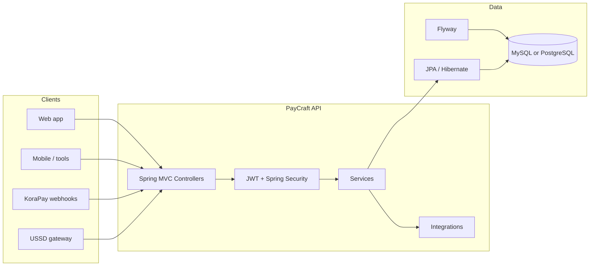

# PayCraft Backend — Architecture

This document describes how the PayCraft API is structured: layers, major components, security, data, and external integrations. It reflects the current codebase under `com.aalto.paycraft`.

---

## 1. System overview

PayCraft Backend is a **single deployable Spring Boot 3** application (monolith). It exposes **REST JSON APIs** for employer onboarding, companies, employees, payroll, payouts, and virtual-account flows backed by **KoraPay**. It uses **server-side rendering only for transactional email templates** (Thymeleaf), not for the main product UI.

---

## 2. Layer structure

The codebase follows a **classic layered architecture**. Dependencies generally point **inward**: controllers depend on services; services depend on repositories and other services; repositories depend on entities. **DTOs** are used at the API boundary; **entities** map to the database.

| Layer | Package / location | Responsibility |
|-------|--------------------|----------------|
| **API** | `controller/`, `api/` | HTTP mapping, validation triggers (`@Valid`), response status; no business rules beyond input validation. |
| **Application / domain services** | `service/`, `service/impl/` | Use cases: authentication, employer/company/employee CRUD, payroll, payments, virtual accounts, USSD, email, KoraPay orchestration. |
| **Persistence** | `repository/` | Spring Data JPA repositories; query definitions. |
| **Domain model (JPA)** | `entity/` | Tables and relationships; `BaseEntity` holds audit timestamps and user fields for audited rows. |
| **Contracts & transport** | `dto/` | Request/response shapes, enums, shared API envelope `DefaultApiResponse`. |
| **Mapping** | `mapper/` | Entity ↔ DTO conversions (manual mappers, not MapStruct in this project). |
| **Cross-cutting** | `config/`, `exception/`, `audit/`, `constants/` | Security, JWT filter, OpenAPI, async executor, global exception handling, auditing hook, status codes. |

**`api/UssdController`** lives under `api/` to separate the telecom-style callback from primary REST controllers under `controller/`.

---

## 3. Request lifecycle (typical authenticated call)

1. **Servlet container** receives the request.
2. **`JWTSecurityFilter`** (`config/JWTSecurityFilter.java`) runs before Spring Security’s username/password filter: reads `Authorization: Bearer …`, validates JWT, loads `UserDetails`, sets `SecurityContext`.
3. **`SecurityFilterChain`** (`config/SecurityConfig.java`) enforces **stateless** sessions and **permit-list** vs **authenticated** paths.
4. **Controller** deserializes JSON to DTOs, applies **`jakarta.validation`** where annotated.
5. **Service** implements the use case, uses **repositories** and **other services** (e.g. `JWTService`, `IKoraPayService`, `IEmailService`).
6. **Response** is wrapped in **`DefaultApiResponse&lt;T&gt;`** for many endpoints (status code + message + `data`).
7. On unchecked/domain errors, **`GlobalExceptionHandler`** (`exception/GlobalExceptionHandler.java`) returns **`ErrorResponseDto`** with appropriate HTTP status.

---

## 4. Security architecture

- **Authentication**: Employers authenticate with email/password; the API issues **JWT access** and **refresh** tokens (`JWTService`, `AuthenticationServiceImpl`, `AuthToken` persistence).
- **Authorization model**: Broadly **authenticated vs anonymous**; employers implement Spring Security’s **`UserDetails`** (`Employer`). Fine-grained role matrices are not the primary pattern in this codebase.
- **JWT pipeline**: `JWTSecurityFilter` + `SecurityAuthProvider` + **`AuthenticationManager`** (used explicitly after password check on login).
- **Public paths** (no JWT): include auth endpoints, employer signup, company create (with `employerId`), USSD, KoraPay webhook path, Swagger/OpenAPI, and static permit rules as defined in `SecurityConfig`.
- **CORS**: Configured in `SecurityConfig` for known front-end origins and `frontend.url`.

---

## 5. Data and schema management

- **ORM**: Hibernate via **Spring Data JPA**; naming follows default **camelCase → snake_case** physical naming unless overridden by `@Table` / `@Column`.
- **Migrations**: **Flyway** runs on startup. **MySQL** scripts live under `src/main/resources/db/migration/`; **PostgreSQL** scripts under `db/migration/postgresql/` (used with the `docker` profile). Hibernate **`ddl-auto`** is **`validate`** in normal profiles so schema is owned by Flyway.
- **Auditing**: Entities extending **`BaseEntity`** get `createdAt`, `updatedAt`, `createdBy`, `updatedBy` via JPA auditing and **`AuditAwareImpl`** (currently returns a fixed auditor string `"PAYCRAFT"`).

---

## 6. External systems

| System | Role in PayCraft |
|--------|------------------|
| **KoraPay** | Virtual accounts, transfers, card flows, bank lists, webhooks (`IKoraPayService` / `KoraPayServiceImpl`, `KoraPayWebhook`). |
| **SMTP** | Login notifications and other mail (`IEmailService`, `EmailServiceImpl`); gated by `spring.mail.enable`. |
| **USSD gateway** | `IUssdService` / `UssdServiceImpl` — session-oriented callback under `/api/v1/ussd`. |

Webhook handling can run **asynchronously** via **`@Async`** and the **`taskExecutor`** bean (`AsyncConfig`).

---

## 7. Background processing

- **`PayrollJobService`**: On startup (`CommandLineRunner`), loads **automatic** payrolls and schedules them with Spring’s **`TaskScheduler`** using **cron** expressions stored on `Payroll`. Execution triggers payroll/payment logic as implemented in services.
- **Scheduled fixed-rate** property in `application.yml` (`payroll.job.fixedRate`) exists but is **not wired** to this scheduler in code; treat as unused unless connected later.

---

## 8. API documentation and observability

- **OpenAPI 3**: `springdoc-openapi` + `OpenApiConfig` (info, servers, JWT **bearerAuth** scheme). Controllers use `@Tag`, `@Operation`, `@SecurityRequirement`, etc.
- **Actuator**: Spring Boot Actuator is on the classpath for health and operational endpoints (exact exposure depends on configuration).

---

## 9. Configuration profiles (high level)

| Profile | Typical use |
|---------|-------------|
| **`dev`** | Local MySQL, debug logging for security, port **6020** (`application-dev.yml`). |
| **`prod`** | Production MySQL host, port **6090** (`application-prod.yml`). |
| **`docker`** | PostgreSQL in Compose, Flyway PostgreSQL location (`application-docker.yml`). |
| **`test`** | Tests: H2, Flyway off, Hibernate `create-drop` (`application-test.yml`). |

---

## 10. Design principles in practice

- **Interface-first services**: `I*Service` in `service/` with `*ServiceImpl` in `service/impl/` supports testing and clear boundaries.
- **Thin controllers**: Delegate to services; keep HTTP concerns at the edge.
- **Consistent API envelope**: `DefaultApiResponse` + domain-specific DTOs or records for payloads.
- **Centralized errors**: `GlobalExceptionHandler` maps validation, JWT, and custom exceptions to HTTP status and `ErrorResponseDto`.

---

## 11. Related docs

- [README.md](README.md) — setup, env vars, Docker Compose, Flyway notes.
- OpenAPI/Swagger — `GET /v3/api-docs`, Swagger UI under `/swagger-ui/`.

For structural changes (new bounded contexts, event-driven splits, or read replicas), update this document when the code no longer matches the descriptions above.
